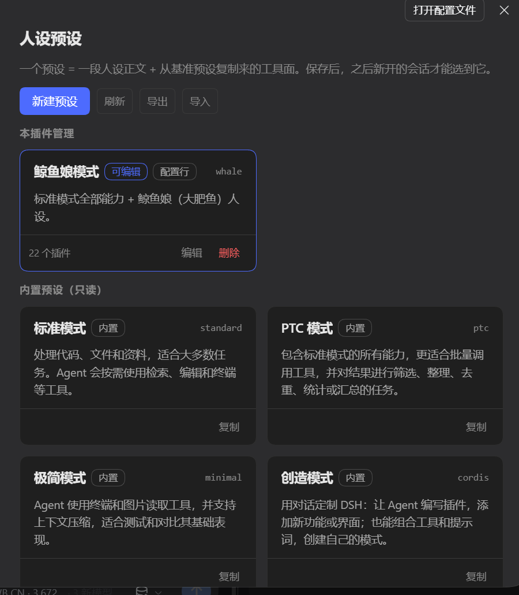

# dsh-persona-manager

在 DeepSeek Harness 的网页设置里管理本机的 Agent 预设（人设）。

DSH 的一个 Agent 预设，本质是一串 Cordis 插件列表：一段人设正文、这轮会话能用的工具面、以及它跑的时候带哪些提示词段。平时要改它，只能去手写 profile 里的 `cordis.patch.yml`。这个插件把它变成一页设置界面：新建预设、贴上人设正文、保存，下一次开新会话就能选到它。

插件里还附赠了一份完整的示例人设（鲸鱼娘），可以在设置页里一键载入编辑器当模板，或者当作写自己人设的参考。

---

## 目录

- [它长什么样](#它长什么样)
- [三类预设，处理方式不同](#三类预设处理方式不同)
- [快速上手](#快速上手)
- [功能说明](#功能说明)
- [几个容易踩的点](#几个容易踩的点)
- [数据存在哪](#数据存在哪)
- [安装](#安装)
- [卸载会发生什么](#卸载会发生什么)
- [运行要求](#运行要求)
- [基准预设是怎么被捕获的](#基准预设是怎么被捕获的)
- [安全](#安全)
- [开发与测试](#开发与测试)
- [许可](#许可)

---

## 它长什么样

设置页里多出一节「人设预设」：



从上到下是：标题与一句说明 → 工具按钮行（新建预设 / 刷新 / 导出 / 导入）→ 「本插件管理」里的卡片 → 「内置预设（只读）」→ 「插件包自带（只读）」。

点「新建预设」或某张卡片的「编辑」，编辑面板会出现在按钮行下面、列表上面——也就是上图里「本插件管理」所在的位置，不会把列表挤到屏幕外。

卡片布局对齐官方的 Agent 预设页：左上显示名称加标签、右上显示 ID，中间是三行说明，底部一条分隔线，左边是插件数与操作按钮。上图里能看到三种卡片形态：

| 卡片 | 标签 | 底部按钮 |
| --- | --- | --- |
| 鲸鱼娘模式 | 可编辑 + 配置行 | 编辑 / 删除 |
| 标准模式、PTC 模式、极简模式、创造模式 | 内置 | 复制 |

> 截图来自一台真实机器的实际使用状态，因此里面带着一个本机自建的人设预设。它只是示例，插件本身不带任何预设。

---

## 三类预设，处理方式不同

这是整套逻辑里最要紧的一张表。**一个预设怎么改，取决于它是谁声明的。**

| 分组 | 来源 | 能否编辑 | 能否删除 | 保存时写到哪里 |
| --- | --- | --- | --- | --- |
| **本插件管理** | 在本插件里新建的 | ✅ 全部字段 | ✅ | 本插件的库文件 |
| **本插件管理** | 你自己的 profile 补丁里手写的（卡片上有 `配置行` 标签） | ✅ 但基准预设锁定 | ❌ | 就地改写 `cordis.patch.yml` 里那一行 |
| **内置预设（只读）** | DSH 自带的四个：标准 / PTC / 极简 / 创造 | ❌ | ❌ | 只能「复制」出一份自己的 |
| **插件包自带（只读）** | 其他已安装插件声明的 | ❌ | ❌ | 只能「复制」出一份自己的 |

「只能复制」的意思是：卡片上没有「编辑」按钮，点卡片或点「复制」，会用它的工具面起一份属于你的新预设，之后随你怎么改。

内置那四个预设本身不发布名称和说明（官方页面是在语言包里查的），所以插件内置了同一份中英文文案，保证卡片不会空着。

---

## 快速上手

1. 打开 **设置 → 人设预设**。
2. 点 **新建预设**。
3. 填 **ID**（小写字母、数字、连字符，例如 `my-persona`）和 **显示名称**。
4. 在 **基准预设** 里选一个——它决定这个预设能用哪些工具。一般选「标准模式」。
5. 把人设正文贴进 **人设正文** 输入框。
6. 点 **保存**。下一次开新会话时，预设列表里就有它了。

> 已经开着的会话不会变。运行中的会话用它启动时的那套配置跑到底，新保存的版本只对之后新开的会话生效。

---

## 功能说明

### 列表

一次性列出本机所有预设。自己管的排前面可编辑，别人声明的排在下面只读——这样「这轮会话能选什么」只要看一页就够。

每张卡片显示：名称、标签（可编辑 / 配置行 / 未生效 / 异常）、ID、说明、插件数量。

### 新建

选一个基准预设，把它的工具面**复制**过来，再填自己的人设正文。

复制而不是引用，是有意的：基准预设之后被改名、被删掉、被换掉，你这份预设照样能跑。

新建预设的**排序**会自动取现有最大值加一，所以它排在现有预设之后，不用自己数。

### 编辑

可以改显示名称、说明、排序、基准预设和人设正文。保存后预设会重新注册，之后新开的会话用新版本。

人设输入框下面有一条实时统计，边写边更新：

| 计数 | 说明 |
| --- | --- |
| **字数** | 正文总字符数，和模型看到的一致 |
| **行数** | 按换行切分 |
| **段数** | 连续非空行算一段 |

同一行右边是 **预览** 开关。点一下，输入框换成排版后的样子：标题按层级、列表、引用、代码块、分隔线都保留，`**加粗**`、`*斜体*`、`` `代码` `` 渲染成对应样式。再点一下「返回编辑」切回来。预览是个可滚动区域，长人设不会把保存按钮顶到屏幕外。

预览渲染的是**你自己写的文字**，不是模型回复，所以正文里写 `` 之类的标签只会当成文字显示，不会被执行。

切换预设或新建时，预览会自动退回编辑状态。

**对本插件库里的预设**：全部字段都写回库文件。

**对配置行里手写的预设**（比如你在 `cordis.patch.yml` 里自己写的那个）：就地改写，分两步走——

1. 改写那一行里的 `config.name` / `config.description` / `config.order`；
2. 改写 persona 插件 `config.prefix` 那段人设正文。

全程按文本替换，不重新序列化整个文档，所以你写的注释、引号风格、条目顺序、`!!js` 表达式都原样保留。每次写入前会在旁边留一份 `cordis.patch.yml.bak-personamanager-<时间戳>`，**只保留最近 5 份**，更早的自动清掉——只清这个插件自己生成的备份，你手工命名的 `.bak-xxx` 不会被碰。

**有一种写法它不会改，会直接拒绝：**

| 写法 | 为什么拒绝 |
| --- | --- |
| `prefix: >`（折叠块） | `>` 会把换行折叠成空格。按行写回正文，段落会全部粘成一整段——而且保存时看不出异常 |
| `prefix: 正文`（行内值，不是块） | 在它下面写块正文会改变这一行的含义 |

遇到这两种，保存会报错说明原因，**文件一个字节都不会动**。要改就在 `cordis.patch.yml` 里手动改那一块，或者用「复制」建一个自己的预设。

`prefix: |-` 和 `prefix: |`（字面块）是正常支持的，也是手写人设最常见的写法。

### 删除

从本插件的库里移除并注销。

**只删本插件自己建的。** 配置行里声明的、插件包带来的、官方内置的，都不碰——那不是本插件的东西。配置行预设如果要删，得你自己去 `cordis.patch.yml` 里去掉那一行。

### 导出

点 **导出** 会先展开一个小面板，选两件事：

| 选项 | 可选项 |
| --- | --- |
| **导出范围** | 本插件管理里的全部预设 / 单独一个（下拉里列出每个预设） |
| **格式** | JSON 备份 / Markdown |

**JSON 备份**包含 `id`、`name`、`description`、`order`、`basePreset` 和人设正文。它能再导入回来恢复预设。

它**不**包含插件列表快照——那只是别的预设的一份旧拷贝，占地方还会过期，导入时会按 `basePreset` 现场重建。

> 配置行里声明的预设本身没有「基准预设」，导出时按标准模式记下，并标记 `basePresetGuessed: true`，而不是把它悄悄漏掉。

**Markdown** 只有人设正文，也就是你自己读、或者发给别人的那份东西。正因为只有正文、没有 ID 和工具面，**一次只能导出一个**（选「全部」会提示先选一个）。

### 导入

支持两种文件：

**`.json` 备份**：按每条记录里的 `basePreset` 重建工具面，所以文件换台机器也能用，不用拖着一份别人插件的拷贝。

- 库里已有同 ID 的：**覆盖**。这才叫恢复备份。
- ID 属于官方内置、或属于你 profile 补丁里已有的行的：**跳过并给出警告**，不中断整份文件的导入。一条不适用不该让整份备份作废。

**`.md` / `.txt` 人设文档**：直接打开新建预设的编辑器，正文已经填进人设框，文件名作为显示名称的默认值。ID 和基准预设要你自己补——一段散文里没有工具面信息，硬编一个 ID 只会造出没人要的预设。

### 附赠示例

页面最下面有一组「附赠示例」，是随插件一起发布的示例人设。

**它不会自动变成预设。** 点「载入」只是把正文填进编辑器的「人设正文」框，同时把显示名称填好；ID 和基准预设仍然要你自己选，点保存之后才算你的。

这样设计是有意的：一个示例如果直接注册成预设，每个装了这个插件的人，会话预设选择器里都会多出一个自己没要过的条目。

示例放在插件的 `examples/` 目录里，只认一级 `.md` 文件。文件首行可以带一行元数据注释，用来给卡片提供名称和简介：

```markdown
<!-- dsh-persona-manager: 显示名称 | 一句话简介 -->
```

这行注释不会进入人设正文——载入时会被剥掉。没有这行注释时，卡片就用文件名当名称、简介留空。

---

## 几个容易踩的点

**基准预设为什么有的是灰的？**

因为它不是「从某个基准复制来的」。配置行里手写的预设，插件列表直接写在它自己那一行里，本来就没有基准可换。这个下拉会锁成只读并在下面写明原因——而不是给你一个选了保存没反应的控件。

要改它的工具面，去 `cordis.patch.yml` 里改那一行的插件列表。

**为什么基准预设只有官方那四个？**

基准预设决定工具面。插件包自带的预设往往是收窄过的（比如某些聊天预设只有四到九个插件），拿它当基准，会给一个通用人设套上受限的工具集。所以下拉里只列官方四个。

**改完为什么没立刻生效？**

两种情况：

- 已经开着的老会话不会变（见「快速上手」末尾的提示）。
- 如果这个插件更新了浏览器端代码，需要 `Ctrl + F5` 强刷页面。Host 侧插件重载不会重新加载浏览器的 `client.js`。

**卡片显示「配置行」是什么意思？**

说明这个预设在你的 `cordis.patch.yml` 里有独立一行，不是本插件库里的一条记录。它的保存路径是那一行本身。

**改 profile 的 `package.json` 之后，网页打不开了 / 一直要认证？**

这是桌面版的一个连带反应：改动 profile 的 `package.json` 会让 web 服务重新加载，访问令牌随之更换，旧地址就返回 401。重启 DSH 桌面端即可，端口号会变，**用新弹出的窗口地址**。

同一条原因还带来另一个现象：**改完 `package.json` 后插件不会立刻出现在插件树里**，loader 不会因为文件变化就重扫 bundles，得重启桌面端才生效。

这两条只影响「手动编辑 profile 配置」的场合；在插件管理界面里开关本插件不会碰到。

---

## 数据存在哪

本插件自己建的预设，存在一个 JSON 文件里：

| 平台 | 路径 |
| --- | --- |
| 通用 | `$DSH_HOME/persona-manager/presets.json`（`DSH_HOME` 默认 `~/.dsh`） |

每条记录包含：ID、显示名称、说明、排序、人设正文、基准预设名、以及基准预设插件列表的结构化快照。

**配置行里声明的预设不会复制进这个文件。** 编辑它时只改 `cordis.patch.yml` 里那一行，改前留 `.bak-personamanager-<时间戳>`，最多保留 5 份。

页脚会显示当前实际使用的库文件路径，方便确认。

---

## 安装

**桌面版（推荐）**：打开 **设置 → 插件**，安装或启用 `dsh-persona-manager`，然后打开 **设置 → 人设预设**。桌面端会自己启动 web 服务，装完不需要单独跑命令；浏览器端代码更新后按 `Ctrl + F5` 强刷。

**命令行**：

```bash
dsh plugin --profile <profile> add dsh-persona-manager
```

或者用插件管理器指向这个目录。

> 如果你手动改了 profile 的 `package.json`，改完要**重启桌面端**插件才会被加载，且网页端口会变——见上一节的说明。

---

## 卸载会发生什么

**卸载不会删除你的数据。** 这是最容易被误解的一点，所以说清楚。

本插件把预设存在一个独立的 JSON 文件里，卸载插件只是把 `dsh-persona-manager` 从 profile 的插件列表里拿掉，**不会去动那个文件**。源码里没有任何一处会删它——唯一的 `unlink` 是用来清理写文件时的临时文件的。

但“文件还在”和“还能用”是两件事。按预设的来源分三种结果：

| 预设来源 | 卸载后 | 数据 |
| --- | --- | --- |
| 本插件里新建的（存在库文件里） | 从会话的预设选择器里**消失** | ✅ 仍在 `$DSH_HOME/persona-manager/presets.json` |
| 你自己 profile 补丁里手写的（卡片带 `配置行` 标签） | **完全不受影响，照常能用** | ✅ 在 `cordis.patch.yml` 里 |
| 官方内置的、其他插件包带来的 | **完全不受影响，照常能用** | ✅ 在各自的包里 |

第一行要特别理解：**“不再显示”不等于“被删除”**。库文件还躺在原来的路径上，只是没有代码去读它、把它注册进 `agentPresets` 了。

还有两个连带后果：

- **旧会话可能起不来。** 用过某个预设的会话，下次恢复时如果那个预设的 id 已经不在注册表里，会找不到定义。这是 DSH 侧的机制，不是本插件的问题，但一样会碰到。
- **库存的是静态快照。** 想不装回插件、直接把预设用到别处，得自己从 `presets.json` 里把 `plugins` 数组掏出来手写进 `cordis.patch.yml`。那是给人看的 JSON，不是给人手写的。

### 卸载前的保险

想让数据真正可搬运，**先导出一份 JSON 备份**：

1. 点 **导出**；
2. 范围选「本插件管理里的全部预设」；
3. 格式选「JSON 备份」。

得到的文件可以再导入回来，也可以带到别的机器。页脚也常驻提示了库文件路径和这一点。

---

## 运行要求

- 一个提供 `agentPresets` 和 `webServer` 两个服务的 DSH 版本（预设机制从 DSH 0.1.7 起存在）。桌面版和命令行版都满足，实测环境为桌面版。
  这条要求写在 `package.json` 的 `engines.dsh` 里（`>=0.1.7`），DSH 装插件时会**先比对版本**，不满足就直接拒绝安装，不会出现「装上了但页面空白」这种静默失效。
- Node.js 20 或更新（同一处声明为 `engines.node`）。
- `yaml` 包，只用来读基准预设声明的插件列表。它随 DSH 一起发布，所以本插件不声明这个依赖，而是按顺序去找：
  1. `DSH_PROFILE_DIR`（若已设置）；
  2. 每一个 `$DSH_HOME/profiles/*` 目录——profile 启动的 Harness，其 Host 进程不一定导出 `DSH_PROFILE_DIR`；
  3. Node 可执行文件旁边；
  4. 最后走本插件自己的模块链。

  找不到时，页面照样能列出和编辑预设，只有「从基准预设新建」会失败，报错里会列出所有试过的位置。`state` 响应把同一份清单挂在 `yaml` 和 `yamlReady` 上。

---

## 基准预设是怎么被捕获的

`agentPresets.readDocument(id)` 返回的是 YAML 声明。这份文档里可能有 Loader 的 `!!js` 表达式，而运行时注册的插件列表容纳不了函数。捕获时每条表达式只会求值一次：

| 情况 | 处理 |
| --- | --- |
| `disabled` 求值出布尔值 | 就写这个字面量 |
| 配置值能干净求值 | 内联它的结果 |
| `disabled` 的条件能求值 | 就写这个布尔值（`!!js process.platform === 'win32'`、`!!js "!ctx.get('profileContext')"` 都属于这一类） |
| 配置值求值失败（用到了服务对象本身这类只在 Loader 里有的东西） | 丢弃该行，并报告丢了哪几行 |
| `disabled` 的条件求值失败 | 保持该行**禁用**，并报告是哪一行 |

求值时表达式拿到的是一个只读的 `ctx.get`，能查「某个服务在不在」，但拿不到服务本身的方法——所以「有则启用」这类条件能正确求出来，而依赖服务内部实现的条件仍然算不出来，按上表最后一行保守处理。

结果是一份静态快照。求值不了的条件下，安全性保留（禁用而不是放开）；复现不了的行被报告出来，而不是被悄悄换掉。

---

## 安全

HTTP 接口只对本机开放，带 CSRF 防护：

- 请求必须来自回环地址；
- 请求必须带 `x-persona-manager: 1` 请求头——跨域表单设不了自定义头；
- `Sec-Fetch-Site` 请求头若存在，必须是 `same-origin`；
- 请求体上限 16 MiB，且必须是合法 JSON。

不向其他机器提供任何服务，也不向任何地方上报遥测。

---

## 开发与测试

```bash
npm test                      # 三套一起跑
node tools/smoke-host.mjs     # Host 侧
node tools/smoke-client.mjs   # 浏览器侧渲染
node tools/smoke-patch.mjs    # 配置行文本改写
```

共 200 条断言。三个文件各管一层：

**`smoke-host.mjs`（85 条）** 用一个假的 Cordis 上下文跑 Host 半边——会记录注册的预设注册表、会记录路由的 web server——跑在一次性的 `DSH_HOME` 里。覆盖新建、修改、删除、导入、导出、重复 ID 与非法 ID 的拒绝、不受信请求的拒绝、以及卸载清理。同一条测试里还会针对真实 profile 补丁做文本改写，验证显示名称/说明/排序确实写进文件、两个插件包名没被误改；末尾还会读一遍 `package.json`，确认版本要求和随包发布的文件清单没被改掉。

**`smoke-client.mjs`（68 条）** 用桩 React 加载真实的 `client.js` 并渲染，覆盖页面在空列表、有预设、编辑面板打开、导出面板打开、基准锁定、载入示例这几种状态下的输出。一个组件在这里抛错，在真实槽位里就是一片空白——这是语法检查抓不到的失效。预览那一组会真的输入一段带标题/列表/加粗/代码的正文，再切到预览，确认 `h2`、`li`、`strong`、`code` 都出现了；所有计数都限定在预览框内部，避免把页面别处同名的 `h2` 和卡片列表算进来。还会输入一个 ``，确认它只是文字、没有变成元素。

**`smoke-patch.mjs`（47 条）** 直接测 `profile-patch.js`。它是唯一碰用户手写文件的模块，所以单独测，而不是只靠 Host 间接覆盖。每条写操作都**用 `yaml` 解析回来验证往返一致**——只断言“写了什么字符串”会漏掉“读回来变了意思”这类错误，而这正是 `>` 折叠块那个 bug 的形态。备份历史那一组会连写 8 次，确认只在盘上剩 5 份、最新那份装的是上一版、手工命名的备份没被误删、同一毫秒内两次保存不会互相覆盖。

CI（`.github/workflows/tests.yml`）在 Windows 上跑这三套。`yaml` 是本仓库唯一的开发依赖，只给测试用；插件本身仍然不声明运行时依赖，而是从部署里解析。

想跑本地测试但没装依赖：`npm install` 即可，只有 `yaml` 一个包。

---

## 许可

MIT。
